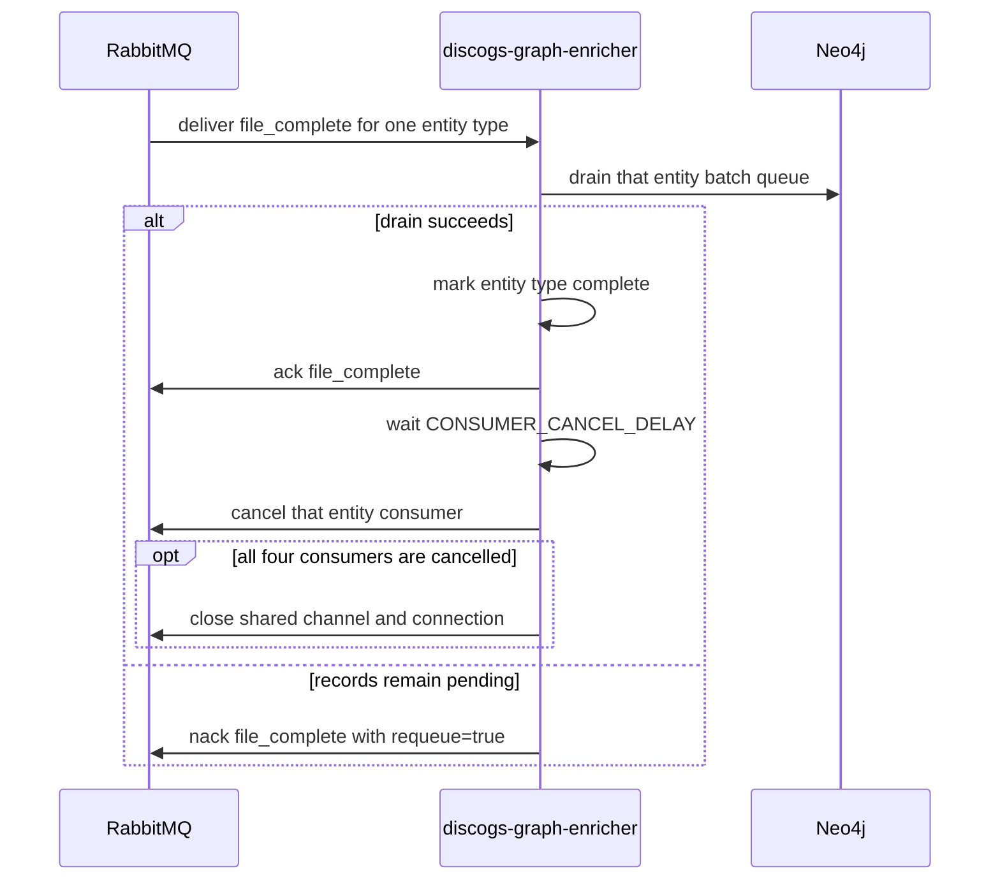

# Consumer cancellation and draining

`discogs-graph-enricher` owns four RabbitMQ consumers, one for each Discogs entity
type. The current producer is
[`discogs-ingestion`](https://github.com/groovemap-music/discogs-ingestion); this
document begins at delivery to this service's durable queues.

## Per-queue completion



The completion marker never overtakes its data. `flush_queue()` waits for an
in-flight batch and drains the in-memory queue before the marker is acknowledged.
If its bounded retries cannot drain the queue, the marker is requeued and the entity
is not marked complete.

`CONSUMER_CANCEL_DELAY` defaults to `300` seconds. A value of `0` disables the
per-queue cancellation timer. Cancellation uses the queue's registered consumer tag
and waits for `CancelOk` (`nowait=False`) with a five-second timeout. A tag and
its active-consumer metric are removed only after confirmation, or after confirmed
channel/connection teardown. Failed or timed-out cancels retain the tag and request
recovery at the next stuck-check interval, even when tags remain present; health
reports unhealthy while recovery is requested. A newer completion marker replaces
an existing timer for the same entity type. When records arrive again, the type's
completion flag and old timer are cleared so the next extraction stays subscribed
and stuck detection re-arms. The shared RabbitMQ channel and connection remain open while any
consumer is active and close after all four consumers are cancelled and all four
entity types are complete.

When idle, the service checks queue depth every `QUEUE_CHECK_INTERVAL` seconds
(default `3600`). If any queue has work, it reconnects and registers consumers for
all four entity types, including types whose queues were empty at the instant of the
depth check. Unexpectedly missing consumers are checked every
`STUCK_CHECK_INTERVAL` seconds (default `30`) and use the same recovery path.

## Terminal signals that arrive after the cancel

The extractor publishes `extraction_complete` to every type only after the last file, so
for a long-running file the earlier types are already cancelled and the signal is queued
with no consumer. A cancelled consumer holds nothing, so the service does not keep it
subscribed for the whole run. While a type is complete, unsubscribed, and its
`extraction_complete` is not yet settled, the periodic checker probes that queue every
`MARKER_CHECK_INTERVAL` seconds (default `5`) with a passive declare and resubscribes
only the type that holds a message. The marker handler re-arms the cancel, so the
consumer goes again `CONSUMER_CANCEL_DELAY` after the marker is settled and what a
consumer may hold is unchanged. If the transport is closed, the same tick runs the full
queue probe.

A queued marker waits at most `MARKER_CHECK_INTERVAL` plus one resubscribe, where it used
to wait for the idle reconnect, up to `QUEUE_CHECK_INTERVAL` (one hour). `/health` lists
the types in that wait as `awaiting_extraction_complete`; an operator console should
treat a queue in that list as an expected wait, not a critical `NO CONSUMER`.

## Process shutdown

SIGINT and SIGTERM use a separate, immediate drain path:

1. Stop delayed cancellation timers and cancel every registered consumer before
   doing slow teardown work. Concurrent confirmation waits share a five-second
   budget; failures are logged and do not block teardown. Connection/channel
   teardown is also bounded to five seconds.
2. Stop progress, recovery, and periodic batch-flush tasks.
3. Ask every batch queue to drain. Records that cannot be written stay pending; a
   transient database outage is not converted into a dead-letter decision.
4. Cancel delayed consumer-cancellation tasks and any detached maintenance task.
5. Close RabbitMQ, then Neo4j, then telemetry and the health server.

This ordering stops new deliveries before the service begins flushing. It also avoids
nacking the same delivery repeatedly while its consumer remains subscribed.
Post-import maintenance is idempotent; if shutdown interrupts it, the next extraction
completion signal or an operator-initiated rerun must perform it again.

## Operations and tests

Health is available at `http://localhost:8001/health` (the role port; `HEALTH_PORT` overrides it). Its `active_consumers`,
`completed_files`, `awaiting_extraction_complete`, `message_counts`, and `current_task` fields describe the local
process; there is no Prometheus scrape route.

```bash
uv run pytest tests/test_file_completion.py tests/test_shutdown_delivery_churn.py \
  tests/test_graphinator.py
```

See [file and extraction completion](file-completion-tracking.md) for the durable
four-signal latch and post-import maintenance gate.
