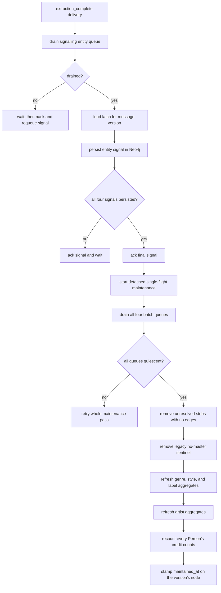

# File and extraction completion

The current [`discogs-ingestion`](https://github.com/groovemap-music/discogs-ingestion)
producer publishes records and terminal control messages through the promoted
[`groovemap.catalog-events` v1 contract](../contracts/catalog-events/v1/contract.json).
This document describes only the consumer-side ordering enforced by
`discogs-graph-enricher`.

## Two completion levels

- `file_complete` says one entity stream has reached its file boundary. The service
  drains that entity's batch queue before acknowledging the marker, then marks the
  type complete and schedules its consumer for cancellation.
- `extraction_complete` says one entity stream has reached the extraction boundary
  for a version. The service drains that entity's queue, persists the signal in
  Neo4j, acknowledges it, and waits for the other entity types.

Both markers are nacked with `requeue=true` when their preceding data cannot be
drained. An extraction signal is also requeued if its durable latch cannot be read or
written.

### How long a marker survives a Neo4j failure

RabbitMQ 4.3.5 and 4.4.0 do not spend `x-delivery-limit` on `nack(requeue=True)`: the count
stays absent and the message never dead-letters. So the service bounds a marker itself:

- `flush_queue` retries for about 15 s (`max_flush_retries` 5, waiting 1, 2, 4 and 8 s), so a
  failure that clears inside that window costs no requeue.
- `requeue_marker` then waits on its own backoff, 2 s doubling to 60 s, before each requeue. A
  marker is not redelivered in a tight loop: a 15 s outage cost 12,076 redeliveries before this
  and at most 5 now, on real RabbitMQ and Neo4j.
- Once the broker's `x-acquired-count` reaches `MARKER_MAX_REQUEUES` (500), the marker is logged
  at critical level and nacked without requeue, so it lands in the DLQ.

A failure shorter than about 8.2 hours loses no marker, provided only nacks return it: that is 500
cycles at the backoff alone, with the early cycles shorter. A channel or connection close does spend
`x-delivery-limit`, so 20 restarts during one outage dead-letter the marker early, with reason
`delivery_limit` and without the critical log. A persistent failure otherwise reaches the DLQ after
about 11 to 12.5 hours, flush retries included.

A file marker's grace timer is cancelled when `extraction_complete` arrives, so the consumer stays
attached while the marker waits, and landing re-arms it. Recovery can lag Neo4j's return by a flush
pass plus 60 s of backoff at worst; the driver's circuit breaker, 30 s, sits inside that.

A dead-lettered `extraction_complete` means that type's signal has not landed and maintenance will
not run for that dump, so replay it from the DLQ once Neo4j is back. DLQs are capped by broker
policy (50,000 messages or 512 MiB by default) with `drop-head`, so under a long outage the oldest
dead letters are discarded: check the DLQ soon rather than leaving a marker there.

## Durable extraction gate



The aggregate steps are resumable. Genre, Style, Label, Artist and Person-credit sweeps run
as short keyed pages (for example `Label.id > $cursor ORDER BY id LIMIT $size`), not as one
statement over the whole graph, so no single transaction is bounded by graph size and the
server's `db.transaction.timeout` is not what limits them. After each page the cursor is
committed to a `MaintenanceCheckpoint` node keyed by step, under a run key of the dump
version and the stats version (`20261101@stats-1`); a retry or a restart continues after the last committed page, a finished step is skipped, and a page
that times out or hits transaction-memory pressure is retried at half the size (the size
that worked is remembered). A new dump version or a new `STATS_VERSION` starts every sweep again. A failing step is
logged by name, the remaining steps still run, and `maintained_at` is only stamped when
every step succeeded; otherwise `maintenance_error` names the failed steps.

The latch is stored as an `ExtractionCompletion` node keyed by the message's
`version`. Changing versions replaces the in-memory cache with the persisted state
for the new version, so signals from two imports cannot satisfy one another. Duplicate
signals are idempotent because the stored `signals` value is a set-like list.

The final message is acknowledged before maintenance begins. Cleanup and aggregate
refreshes can take much longer than RabbitMQ's consumer acknowledgement timeout; the
AMQP delivery is therefore not used as their retry token. Maintenance runs detached,
single-flight, and retries the whole idempotent pass with backoff. Before deleting
stubs it calls `flush_all()` so a transiently requeued batch from any entity type
cannot race cleanup.

Maintenance performs these steps in order:

1. Drain artists, labels, masters, and releases queues, including in-flight batches.
2. Delete unresolved Artist, Label, Master, and Release stubs without `sha256` that
   carry no relationships. A stub that still has edges is a dangling reference from a
   fully imported record and is kept so a later dump can fill it in place.
3. Delete the `(:Master {id: "0"})` node that graphs loaded before the Discogs
   "no master" sentinel fix may still carry, detaching its edges in chunks first.
4. Recompute the Genre, Style, and Label aggregate properties and the `HAS_STYLE` edges
   documented in the
   [service reference](../graphinator/README.md#-pre-computed-node-properties).
5. Recompute the Artist aggregate properties documented in the same reference.
6. Recount `credit_count` and `credit_count_<category>` on every Person — one count per
   category in the shared `common.credit_roles.ALL_CATEGORIES` vocabulary, each the
   number of distinct releases the person is `CREDITED_ON` with that category, plus the
   distinct-release total. The recount is full rather than incremental, so a credit a
   re-imported release no longer lists (its `CREDITED_ON` edge is pruned during the
   import) stops counting; a category the person no longer has reads `0`. People are
   batched per inner transaction and the batch halves under transaction-memory pressure,
   like the stub sweep. See the
   [service reference](../graphinator/README.md#-pre-computed-node-properties).

If all retry attempts fail, logs report that stubs, aggregates, and credit counts may be
stale.
Shutdown cancels an active maintenance task; because each step is idempotent, a later
completion signal or explicit operator rerun can safely repeat it.

## Maintenance completion stamp (`maintained_at`)

`ExtractionCompletion.maintained_at` is the stable, durable signal that the graph is
final for that dump: all four `extraction_complete` signals arrived **and** the detached
maintenance above succeeded. Consumers (for example deployment's Discogs-import-complete
gate) should treat `signals` containing all four types as "import drained" and
`maintained_at IS NOT NULL` as "graph final". Properties on the node, all independent
per `version`:

| Property | Meaning |
| --- | --- |
| `maintained_at` | Datetime stamped as the last step of a successful pass. Set once; re-runs keep the first value. Absent means not final. |
| `maintenance_status` | `succeeded` or `failed` (outcome of the most recent finished pass). |
| `maintenance_error` | Truncated reason from a pass that failed every retry. Cleared by a later success. Never coexists with a failure recorded after `maintained_at`: a stamped node is not modified by later failures. |
| `maintenance_failed_at` | When `maintenance_error` was recorded. |
| `stats_version` | The `STATS_VERSION` the dump's stats were last written at. See [the stats refresh](#stats-refresh-on-a-stamped-dump-stats_version). |
| `label_longevity_rank_of` | M, the number of labels carrying a `longevity_rank`, written by the dump's pass or stats refresh. See [Label longevity](../graphinator/README.md#label-longevity). |

Guarantees:

- The stamp is written only after every sweep succeeded, under `extraction_latch_lock`
  and touching only `maintenance_*` properties (never `signals`). A stamp that cannot
  be written fails that attempt and is retried with the rest of the pass.
- A failed pass records `maintenance_error` and **no** stamp. Shutdown records neither.
- Restart: the final signal is acked before maintenance starts, so the node is the only
  record. On startup `resume_pending_maintenance()` re-runs maintenance when the newest
  version has all four signals and no `maintained_at` (including after a recorded
  failure). Older versions are superseded and not resumed. A redelivered final signal
  for an already-stamped version skips maintenance.
- No runtime DDL: the node is still matched by `version`.

## Stats refresh on a stamped dump (`stats_version`)

A dump stamped by older code never gets the stats that code did not write:
`maintained_at` stops `resume_pending_maintenance()`, and the old checkpoints mark the steps
done. The next dump can be a month away. So `STATS_VERSION` in `graphinator/graphinator.py`
names what the sweeps write, and each pass records it as
`ExtractionCompletion.stats_version`.

At every start, if the newest dump has all four signals and `maintained_at`, and its
`stats_version` differs from the code's, `resume_stats_refresh()` runs every stats sweep
once: Genre, Style and Label, then Artist. Running them all means a dump stamped by any older
stats version gets everything it is missing (version 1 added the Label `HAS_STYLE` edges and
the Artist stats, version 2 the Genre/Style year series). A sweep whose values have not
changed writes nothing on Label and Artist, so the cost is the walk. Deploying is the whole
trigger: there is no manual step. Bump `STATS_VERSION` whenever a sweep's output changes.

- It never touches `maintained_at`, `maintenance_status` or `maintenance_error`, so readers
  keep seeing a final graph while the values arrive.
- The run key includes the stats version, so older checkpoints do not skip it, and a retry
  or restart continues after the last committed page.
- A failed refresh is logged and retried at the next start. `stats_version` is written
  only once every sweep has finished.
- It has its own task slot, and only one runs at a time. A real maintenance trigger cancels
  it, because that trigger is acked and cannot be replayed, and the pass writes every stat.
- It stops between pages if a catalog message arrives or a newer version appears. Messages
  are checked before every page, because a new dump writes long before its first
  `ExtractionCompletion` node exists. That dump's own pass then writes the stats.
- This relies on one service instance, the deployed shape: a second running instance would
  repeat the work. Every write is guarded and idempotent, so that wastes time and changes
  no value.
- Recovery depends on why it ended. A refresh stopped by a newer dump is finished by that
  dump's own pass, which writes every stat. One stopped by arriving messages, or failed, stays
  unstamped and continues after its last committed page at the next restart, or is replaced by
  the next dump's pass. Nothing retries it while the service keeps running.
- A later `STATS_VERSION` does not withdraw the old marker: `stats_version` keeps its old value
  until the refresh finishes, so a reader checking `stats_version >= 1` keeps trusting
  `HAS_STYLE` while that refresh is rewriting it. Before a bump that changes those edges, raise
  the minimum those readers require, or they can read a part-written set.
- `STATS_VERSION` 3 added the Label longevity fields (`first_year`, `last_year`, `years_active`,
  `total_releases`, `peak_decade`). A reader of those requires `stats_version >= 3`, and falls back to the
  live traversal on a label with no `total_releases`. See
  [Label longevity](../graphinator/README.md#label-longevity).
- `STATS_VERSION` 4 added `longevity_rank` on each ranked Label and `label_longevity_rank_of` (M)
  on the dump's `ExtractionCompletion` node. The ranking runs after the last Label page and
  before the stamp, so a reader of either requires `stats_version >= 4`. See
  [Label longevity](../graphinator/README.md#label-longevity).

### Deploying `STATS_VERSION` 1

Deploy this after the Discogs load has finished. The refresh starts on its own right after
the deploy and writes to Neo4j on lux:

| | Estimate for lux | Basis |
| --- | --- | --- |
| Refresh time | about 12 minutes, in the 10 to 15 minute range | 10,287 Artist pages at 61 ms, plus about 75 s for the HAS_STYLE edges |
| Store growth | about 0.8 GB | 0.38 GB of edges and up to 0.42 GB on Artist |
| Later passes | about 9 minutes added, less for unchanged data | 47 ms per Artist page, plus about 45 s for reading the edges |

Reads were measured on lux (44 ms per Artist page across five sampled pages, and about 5.0M
edges from two 1% samples of 2.43M labels). Writes and store size were measured on a
disposable Neo4j, so lux's write rate may differ:

- 75.3 bytes per `HAS_STYLE` edge (34.1 relationship, 41.2 property) and 41.2 bytes per
  Artist, on 500,001 Artists with the same five properties as lux and 2,108,503 edges.
- 14 ms of writes per Artist page, 3 ms per checkpoint, and 15 µs per edge created. Reading
  an unchanged edge adds 9 µs. On lux the Label page read itself costs 42% fewer db hits
  (6.38M to 3.67M across five sampled pages), which offsets part of that.

The largest pages were proven on the same real Neo4j, with lux's 10-minute transaction
timeout and a 512 MiB transaction-memory cap (lux has 3 GiB), at lux's real hub sizes. Neither
page needed a retry.

| Page | Hub | Time | Peak transaction memory |
| --- | --- | --- | --- |
| Artist, with Various | 1,361,622 releases on 176,001 labels | 4.6 s | 49.3 MB |
| Label, with 1818 | 762,594 releases by 495,001 artists | 2.2 s | 60.0 MB |

The Neo4j readers in `catalog-api` must land after this refresh, or keep their live fallback
until then. Until it finishes, the new Artist properties and `HAS_STYLE` edges are missing
or partial.

Follow-up (deployment repo, not part of this change): once a release containing this
stamp ships, `just discogs-import-status` in `groovemap-music/deployment` should require
`maintained_at IS NOT NULL` for the version, not only the four signals.

## Verification

```bash
uv run pytest tests/test_file_completion.py \
  tests/test_extraction_latch_durable.py \
  tests/test_batch_processor.py \
  tests/test_post_import_maintenance_detached.py \
  tests/test_maintained_at_stamp.py \
  tests/test_person_credit_counts.py
```

See [consumer cancellation](consumer-cancellation.md) for the per-queue grace timer,
idle recovery, and shutdown sequence.
