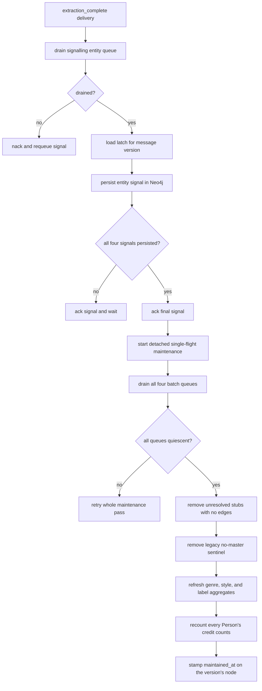

# File and extraction completion

The current [`discogs-ingestion`](https://github.com/groovemap-music/discogs-ingestion)
producer publishes records and terminal control messages through the promoted
[`groovemap.catalog-events` v1 contract](../contracts/catalog-events/v1/contract.json).
This document describes only the consumer-side ordering enforced by
`discogs-graph-enricher`.

## Two completion levels

- `file_complete` says one entity stream has reached its file boundary. The service
  drains that entity's batch queue before acknowledging the marker, then marks the
  type complete and schedules its consumer for cancellation.
- `extraction_complete` says one entity stream has reached the extraction boundary
  for a version. The service drains that entity's queue, persists the signal in
  Neo4j, acknowledges it, and waits for the other entity types.

Both markers are nacked with `requeue=true` when their preceding data cannot be
drained. An extraction signal is also requeued if its durable latch cannot be read or
written.

## Durable extraction gate



The aggregate steps are resumable. Genre, Style, Label and Person-credit sweeps run as
short keyed pages (for example `Label.id > $cursor ORDER BY id LIMIT $size`), not as one
statement over the whole graph, so no single transaction is bounded by graph size and the
server's `db.transaction.timeout` is not what limits them. After each page the cursor is
committed to a `MaintenanceCheckpoint` node keyed by step and dump version; a retry or a
restart continues after the last committed page, a finished step is skipped, and a page
that times out or hits transaction-memory pressure is retried at half the size (the size
that worked is remembered). A new dump version starts every sweep again. A failing step is
logged by name, the remaining steps still run, and `maintained_at` is only stamped when
every step succeeded; otherwise `maintenance_error` names the failed steps.

The latch is stored as an `ExtractionCompletion` node keyed by the message's
`version`. Changing versions replaces the in-memory cache with the persisted state
for the new version, so signals from two imports cannot satisfy one another. Duplicate
signals are idempotent because the stored `signals` value is a set-like list.

The final message is acknowledged before maintenance begins. Cleanup and aggregate
refreshes can take much longer than RabbitMQ's consumer acknowledgement timeout; the
AMQP delivery is therefore not used as their retry token. Maintenance runs detached,
single-flight, and retries the whole idempotent pass with backoff. Before deleting
stubs it calls `flush_all()` so a transiently requeued batch from any entity type
cannot race cleanup.

Maintenance performs these steps in order:

1. Drain artists, labels, masters, and releases queues, including in-flight batches.
2. Delete unresolved Artist, Label, Master, and Release stubs without `sha256` that
   carry no relationships. A stub that still has edges is a dangling reference from a
   fully imported record and is kept so a later dump can fill it in place.
3. Delete the `(:Master {id: "0"})` node that graphs loaded before the Discogs
   "no master" sentinel fix may still carry, detaching its edges in chunks first.
4. Recompute the Genre, Style, and Label aggregate properties documented in the
   [service reference](../graphinator/README.md#-pre-computed-node-properties).
5. Recount `credit_count` and `credit_count_<category>` on every Person — one count per
   category in the shared `common.credit_roles.ALL_CATEGORIES` vocabulary, each the
   number of distinct releases the person is `CREDITED_ON` with that category, plus the
   distinct-release total. The recount is full rather than incremental, so a credit a
   re-imported release no longer lists (its `CREDITED_ON` edge is pruned during the
   import) stops counting; a category the person no longer has reads `0`. People are
   batched per inner transaction and the batch halves under transaction-memory pressure,
   like the stub sweep. See the
   [service reference](../graphinator/README.md#-pre-computed-node-properties).

If all retry attempts fail, logs report that stubs, aggregates, and credit counts may be
stale.
Shutdown cancels an active maintenance task; because each step is idempotent, a later
completion signal or explicit operator rerun can safely repeat it.

## Maintenance completion stamp (`maintained_at`)

`ExtractionCompletion.maintained_at` is the stable, durable signal that the graph is
final for that dump: all four `extraction_complete` signals arrived **and** the detached
maintenance above succeeded. Consumers (for example deployment's Discogs-import-complete
gate) should treat `signals` containing all four types as "import drained" and
`maintained_at IS NOT NULL` as "graph final". Properties on the node, all independent
per `version`:

| Property | Meaning |
| --- | --- |
| `maintained_at` | Datetime stamped as the last step of a successful pass. Set once; re-runs keep the first value. Absent means not final. |
| `maintenance_status` | `succeeded` or `failed` (outcome of the most recent finished pass). |
| `maintenance_error` | Truncated reason from a pass that failed every retry. Cleared by a later success. Never coexists with a failure recorded after `maintained_at`: a stamped node is not modified by later failures. |
| `maintenance_failed_at` | When `maintenance_error` was recorded. |

Guarantees:

- The stamp is written only after every sweep succeeded, under `extraction_latch_lock`
  and touching only `maintenance_*` properties (never `signals`). A stamp that cannot
  be written fails that attempt and is retried with the rest of the pass.
- A failed pass records `maintenance_error` and **no** stamp. Shutdown records neither.
- Restart: the final signal is acked before maintenance starts, so the node is the only
  record. On startup `resume_pending_maintenance()` re-runs maintenance when the newest
  version has all four signals and no `maintained_at` (including after a recorded
  failure). Older versions are superseded and not resumed. A redelivered final signal
  for an already-stamped version skips maintenance.
- No runtime DDL: the node is still matched by `version`.

Follow-up (deployment repo, not part of this change): once a release containing this
stamp ships, `just discogs-import-status` in `groovemap-music/deployment` should require
`maintained_at IS NOT NULL` for the version, not only the four signals.

## Verification

```bash
uv run pytest tests/test_file_completion.py \
  tests/test_extraction_latch_durable.py \
  tests/test_batch_processor.py \
  tests/test_post_import_maintenance_detached.py \
  tests/test_maintained_at_stamp.py \
  tests/test_person_credit_counts.py
```

See [consumer cancellation](consumer-cancellation.md) for the per-queue grace timer,
idle recovery, and shutdown sequence.
